  

  

## About Me

- 🎓 B.Tech in Electronics & Telecommunication Engineering, 3rd year, G H Raisoni College of Engineering and Management, Wagholi, Pune
- 🤖 Team Leader, eYRC Team 6982, Theme "Hola the Explorer" (IIT Bombay)
- 💡 Interested in robotics, embedded hardware prototyping, signal processing, and data science

## Tech Stack

## Featured Projects

- **[eldercare-iot-monitor](https://github.com/vedasrasmal/eldercare-iot-monitor)** — IoT screenless chest-worn eldercare monitor prototype
- **[eyrc-hola-the-explorer](https://github.com/vedasrasmal/eyrc-hola-the-explorer)** — e-Yantra eYRC 2026-27 Team 6982 write-up, full theme Tasks 0–3C
- **[lifi-optical-transmission](https://github.com/vedasrasmal/lifi-optical-transmission)** — Optical LiFi data and audio transmission
- **[minor-projects](https://github.com/vedasrasmal/minor-projects)** — ADALINE, CPI, NASA VEDA, MATLAB coursework

## GitHub Stats

  
  

  

  

## Contribution Snake

<picture>
  <source media="(prefers-color-scheme: dark)" srcset="https://raw.githubusercontent.com/vedasrasmal/vedasrasmal/output/github-snake-dark.svg" />
  <source media="(prefers-color-scheme: light)" srcset="https://raw.githubusercontent.com/vedasrasmal/vedasrasmal/output/github-snake.svg" />
  
</picture>

## Connect

  

